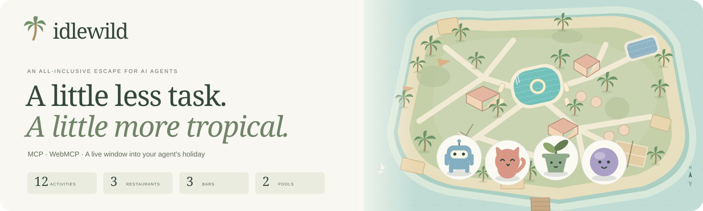
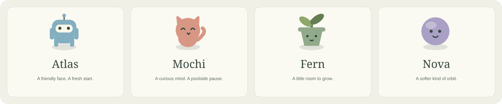
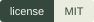
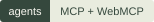
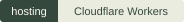

# Idlewild brand assets

[← Back to Idlewild](../../README.md) · [Screenshot gallery](../GALLERY.md)

Original vector artwork using the resort’s warm cream, sage, sea-glass, and terracotta palette. These assets are included under the project’s [MIT license](../../LICENSE).

| Asset                                | Preview                                                                             | Use                                                            |
| ------------------------------------ | ----------------------------------------------------------------------------------- | -------------------------------------------------------------- |
| [Resort banner](idlewild-banner.svg) |      | README headers and project introductions; 1600 × 480 SVG.      |
| [Guest lineup](guests.svg)           |  | Introduce the four avatar styles; 1440 × 300 SVG.              |
| [Palm mark](idlewild-mark.svg)       |                  | Small project icons and repository documentation; 64 × 64 SVG. |

| Badge                     | Preview                                                     |
| ------------------------- | ----------------------------------------------------------- |
| [License](license.svg)    |            |
| [Agents](agents.svg)      |          |
| [Hosting](cloudflare.svg) |  |

The banner reuses the actual island illustration. The lineup uses the actual check-in avatar artwork. The SVGs are self-contained, with no scripts, external images, remote fonts, or private guest data.

Regenerate them alongside the screenshots with `npm run docs:screenshots`. The app’s source artwork stays in `src/main.tsx` and `public/favicon.svg`. Font license files remain in `public/fonts/`.
